# Находки: стенд 13.10.2026 и разводка платы (PDFN 5×6, 2 × WMB043 на ключ)

**Что это.** Обоснование к заданию `../REV0_1_TASK.md`: что показал стенд, что за этим стоит в разводке rev0,
картинки и числа. **Задание — в `REV0_1_TASK.md`; таблица §5 здесь — его краткая версия с причинами.**

Подготовлено в проекте `~/Git/PC/power_loss_calc` (pslc), где лежат данные стенда (§10). Разводка разобрана по
`Power.kicad_pcb` rev0 (в ветках `main` и `rev1` файл одинаков). Следующая ревизия с TOLT — только §9.

Пометки:

| Пометка | Смысл |
|---|---|
| **Стенд** | измерено осциллографом 13.10, точность — §1 |
| **Разводка** | найдено в `Power.kicad_pcb` скриптом (координаты в мм, как в KiCad) |
| **Оценка** | расчёт; диапазон указан |
| **Гипотеза** | объяснение, которое проверяет опыт из §7 |

---

## 0. Коротко

| Что видно на стенде | Что в разводке | Что менять |
|---|---|---|
| **Выброс при выключении нижнего ключа (LS) 83–87 В при 120 А на шине 48 В** (ΔV 33–37 В). Спад тока ~6 нс. На шине 72 В это было бы за 100 В | Возврат затвора LS идёт через слои GND, общая с силовым током часть — только у выводов истока (L_cs ≈ корпус). Обратный путь петли коммутации — слой In3, а он под ключами нарезан дорожками. У ключей только 0603 | Не резать In3 под ключами: нужные дорожки (затворы, NTC) переложить в «свою» медь — полосу GND или узел (§5, п. 1); 1206/1210 по 100 В у каждой стойки; площадки RC-снаббера; раздельный путь выключения затвора |
| У верхнего ключа (HS), по прежним данным, выброс меньше (8–16 В) | Возврат затвора HS (вывод SW драйвера) подключён к узлу у шунта, в 15–25 мм от истоков HS. Петля затвора HS ≈ 6 × 28 мм охватывает сам ключ | Вести HO и SW парой к выводам истока HS; LO и GND — парой к истоку LS |
| Наброс на затвор выключенного LS 2.8–3.4 В при пороге 2.9 В (min 2 В) | Драйверы D4–D6 в 17–30 мм от ключей, дорожки HO/LO 27–35 мм по In3 | Драйвер ближе или затворные пары; места под C_gs у выводов |
| На плате B при 20 А узел проседает до 24 В через ~70 нс после включения HS (HS частично закрывается) | Входы HI/LI (0.3 мм, F.Cu) начинаются у конца пура узла; RC-фильтра на входах нет (даташит NSD1624 его рекомендует) | RC 2–5 Ом / 100 пФ у HI/LI; трассы HI/LI — подальше от узла, над GND |
| Фазы стенд пока не сравнивал (снята только фаза C) | Фазы несимметричны: 0603 у C — 2, у B — 1, у A — 3; виа GND у истоков LS: 92 / 38 / 34 (C / B / A); виа узла у истоков HS: 6 / 65 / 40 | Выровнять фазы; снять одинаковый набор на всех фазах (§7) |

---

## 1. Что и как измеряли (стенд)

| | |
|---|---|
| Плата | две собранные платы этой разводки: **A** — R_g 2.7 Ом + диод Шоттки (1N5819WS или PMEG4010BEA) в обход R_g на выключение; **B** — R_g 1 Ом на оба фронта |
| Режим | шина 48 В от лабораторного источника, провода < 1 м; двигатель в стопоре; 20 кГц, dead time 500 нс; ток фазы 0…120 А амплитуды |
| Где | **только фаза C**: Q1/Q7 — HS, Q8/Q4 — LS, драйвер D4, шунт R7, втулка J1 |
| Чем | Rigol DHO924, пассивные щупы ×10 с пружинной землёй на выводе истока LS; фото экрана оцифрованы |
| Точность | время ±0.4 нс при 20 нс/дел (+ шаг выборки 0.8–1.6 нс); уровни ±0.1–0.2 деления |
| Ограничения | одна фаза; 48 В; ≤ 120 А; на выводах корпуса, не на кристалле; наводку на щуп ещё не проверяли (§7, Р1) |

Протокол со всеми снимками — `power_loss_calc/docs/validation/bench_2026-10-13/protocol.md`.

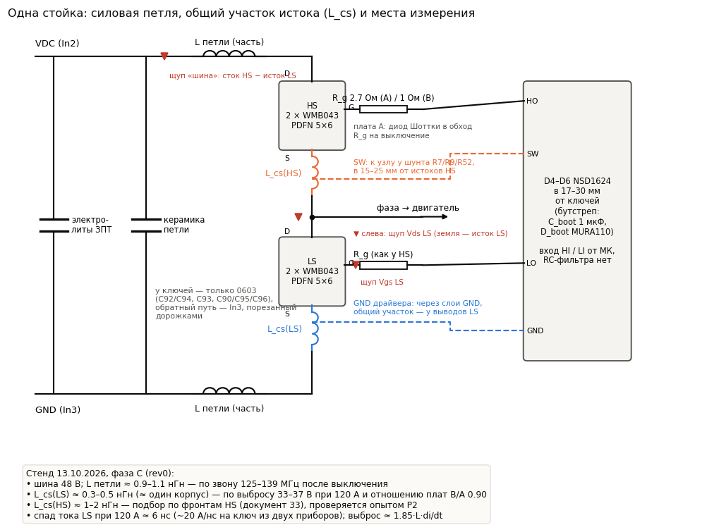

*Рис. 1. Одна стойка: силовая петля, общий участок истока у HS и LS, где стояли щупы.*

---

## 2. Разводка rev0: что найдено

### 2.1 Силовой блок

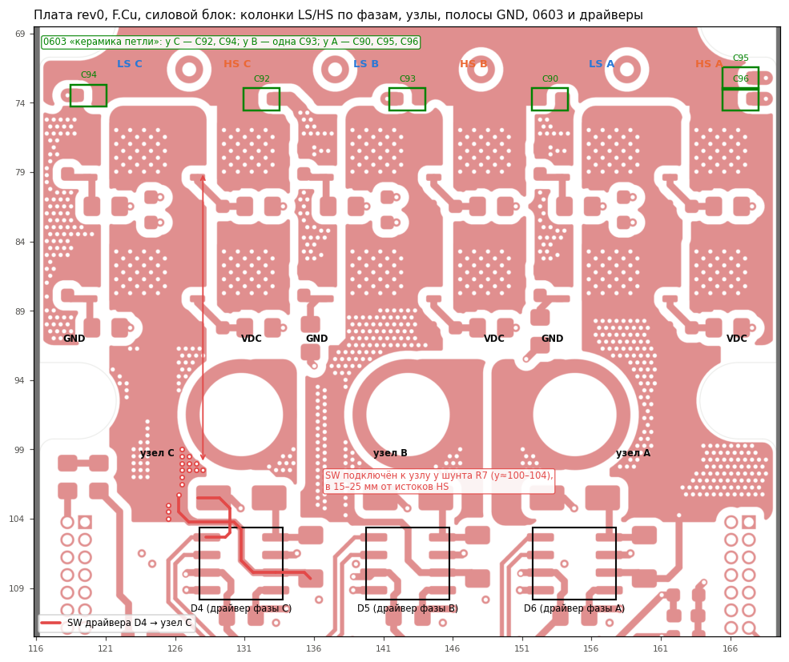

*Рис. 2. F.Cu, блок ключей. Колонки LS/HS по фазам, пуры узлов, полосы GND, 0603 у блока (зелёным), драйверы
D4–D6 внизу. Красным — путь от вывода SW драйвера D4 к узлу фазы C.*

**Разводка:**
- Раскладка по x — колонками, у каждой фазы [исток LS | LS | узел | HS | сток HS]:
  `GND 116–121 | LS C 122.75 | узел C | HS C 130.5 | GND 134–138 | LS B 139.75 | узел B | HS B 147.5 | GND 151–155 | LS A 156.75 | узел A | HS A 164.5`.
  Сток HS (VDC) и исток LS одной фазы — на противоположных краях колонки, ~13–14 мм друг от друга. Петля
  коммутации замыкается через внутренние слои под узлом.
- У PDFN-8L в D-площадке 28 сквозных отверстий (тепло и ток вниз). Выводы истока S (3 пэда) и затвора G — на
  F.Cu, к внутренним слоям через отдельные виа.
- Керамика у блока — только 0603 на F.Cu при y ≈ 72–74: фаза C — C92 (у HS), C94 (у LS); фаза B — одна C93;
  фаза A — C90, C95, C96. В схеме у них 2.2 мкФ; на 100 В в 0603 фактически десятые доли мкФ
  (`REV1_TASK.md` §0.3).
- **Виа у выводов истока, внутри блока (y 73–92):**

  | | Фаза C | Фаза B | Фаза A |
  |---|---|---|---|
  | GND у истоков LS | 92 | 38 | 34 |
  | узел у истоков HS | 6 | 65 | 40 |

  Ниже блока, к шунту (y 92–104), виа узла: 55 / 70 / 128 (C / B / A).

### 2.2 Слои: пара VDC/GND есть, но под ключами она порезана

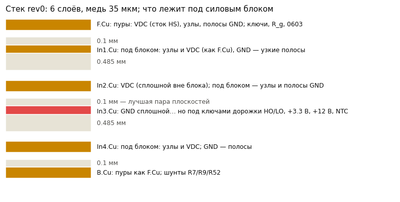

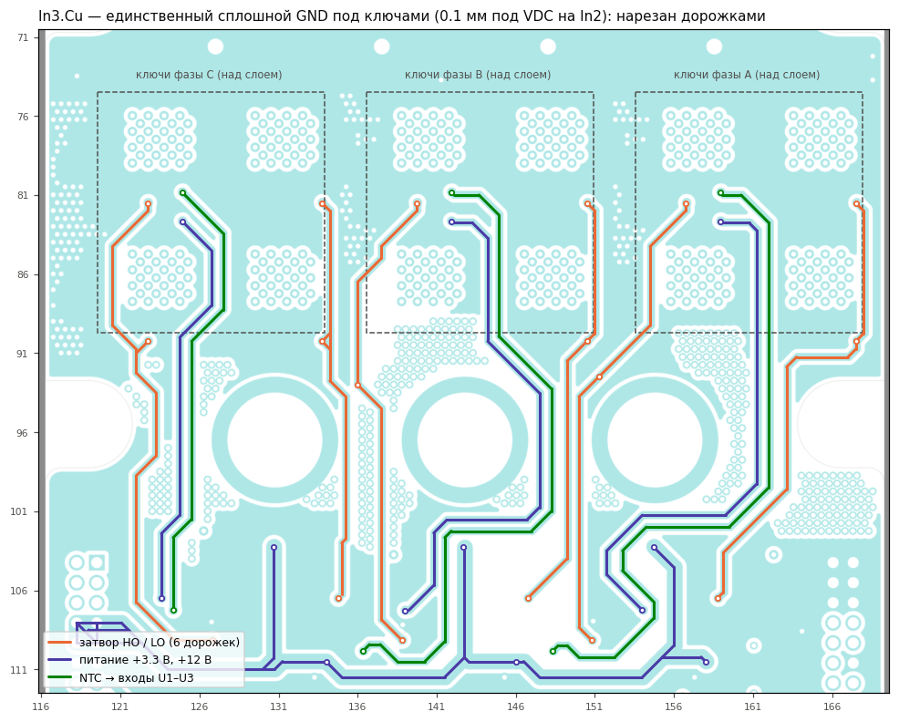

*Рис. 3. In3.Cu, блок. Цветом — дорожки, проходящие через слой GND под ключами.*

**Разводка:**
- Стек: F.Cu — 0.1 — In1 — 0.485 — In2 — **0.1** — In3 — 0.485 — In4 — 0.1 — B.Cu, медь 35 мкм на всех
  слоях.
- **In2 (VDC) и In3 (GND) разделены 0.1 мм — лучшая пара плоскостей платы.** Это естественный обратный путь петли
  коммутации.
- Под блоком In1, In2 и In4 заняты пурами узлов и VDC; GND там только узкими полосами. **In3 — единственный
  сплошной GND под ключами.**
- **In3 под ключами нарезан:** шесть затворных дорожек HO/LO (по 13–23 мм внутри блока, всего 27–35 мм каждая),
  +3.3 В к термисторам, три цепи NTC → входы U1–U3 (`Net-(U1-+)` … `Net-(U3-+)`). +12 В (дорожка 1 мм) идёт по
  In3 ниже блока, под втулками и шунтами. Ток петли коммутации обходит прорези.
- **Все эти дорожки нужны.** Под блоком они оказались на In3, потому что In1, In2 и In4 там заняты пурами узлов и
  VDC. Термисторы TH1–TH3 стоят на пуре узла между двумя LS, и их цепям другого слоя нет. Как их переложить, не
  теряя связей, — §5, п. 1.

### 2.3 Петли затворов

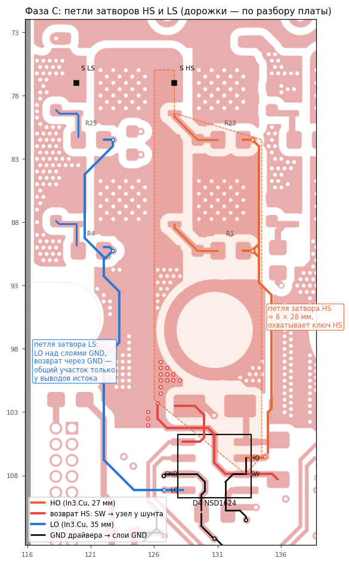

*Рис. 4. Фаза C: HO и LO по In3, возврат HS через SW у шунта, возврат LS через слои GND.*

**Разводка** (все три фазы устроены одинаково):

| | Фаза C (D4) | Фаза B (D5) | Фаза A (D6) |
|---|---|---|---|
| Драйвер | (130.75, 107.25) | (142.75, 107.25) | (154.75, 107.25) |
| Истоки HS | x 127.6, y 75.6…86.9 | x 144.6 | x 161.6 — на 7 мм в сторону от драйвера |
| HO, длина | F.Cu 3.1 + **In3 26.9** мм | 3.1 + 27.0 | 3.1 + 30.9 |
| LO, длина | F.Cu 3.1 + **In3 34.7** мм | 3.3 + 30.4 | 3.6 + 30.8 |
| SW (вывод 6) → узел | у шунта R7, y ≈ 100–104 | у R9, y ≈ 102.5 | у R52, y ≈ 102.5 |
| GND (вывод 3) → | via (126.75, 108.0) на слои GND | так же | так же |

- **Затвор LS:** LO идёт по In3 над соседними слоями GND, возврат — через плоскости GND к выводам истока.
  Общий с силовым током участок — только выводы и их виа. **Это и есть малая L_cs(LS) со стенда.**
- **Затвор HS:** HO идёт по In3 вдоль x ≈ 134–135. Возврат идёт от выводов истока HS по пуру узла вниз к шунту и
  дорожкой к SW. Петля ≈ 6 × 28 мм охватывает сам ключ HS: путь ток стока → исток лежит внутри неё. Отсюда
  большая индуктивность петли затвора HS и связь с силовым контуром.
- R_g (2.7 Ом, 0805) и R_gs (10 кОм) стоят у ключей: HS — R23/R1 справа над стоком, LS — R25/R4.
- **Бутстреп** (D1–D3 MURA110, C7–C9 1 мкФ) — у драйвера, петля BST–C_boot–SW короткая. Замечаний нет.

### 2.4 Входы драйверов

**Разводка:** HI/LI (`/TMR1_CHx`, `/TMR1_CHxN`) — дорожки 0.3 мм по F.Cu, 28–34 мм от U5 к D4–D6. Начинаются у
выводов 1–2 драйвера, в 1–3 мм от конца пура узла (y 104.2) и куста виа узла (y 100–104). RC-фильтра на входах
нет (лист `Driver`: D1, C7, C1, D4). Даташит NSD1624 §7.3 рекомендует R 2–5 Ом + C 100 пФ у выводов HI/LI.

---

## 3. Стенд ↔ разводка: находки по одной

### 3.1 Выброс при выключении LS — главное

**Стенд:**

| Ток фазы | Плата A | Плата B |
|---|---|---|
| 20 А | 53 В (ΔV 3) | 53 В (ΔV 3) |
| 60 А | 71 В (ΔV 22) | ≥ 69 В (срез экрана) |
| 100 А | 82 В (ΔV 33) | ≥ 69 В (срез экрана) |
| 120 А | **86–87 В (ΔV 37)** | **83 В (ΔV 33)** |

- Звон 125–139 МГц → L петли ≈ 0.9–1.1 нГн (с Coss двух выключенных, 1.5 нФ).
- Спад тока ~6 нс (≈ 20 А/нс на ключ). Выброс ≈ 1.85·L·di/dt: звон почти не демпфирован.

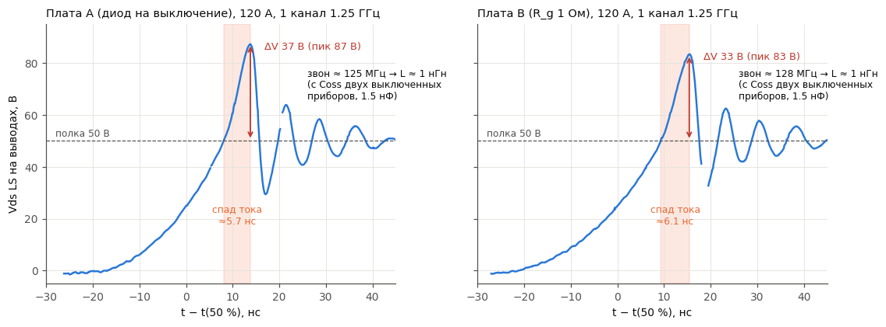

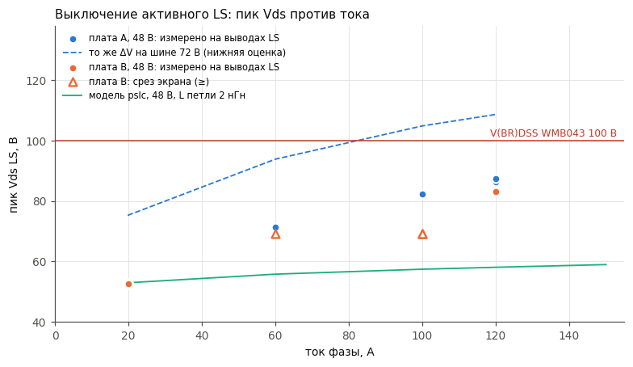

Vgs и Vds выключения при 20 / 60 / 120 А на обеих платах — `img/f4_turnoff_vgs_vds.png`.

| A, 120 А (снимок 27) | B, 120 А (снимок 38) |
|---|---|
| 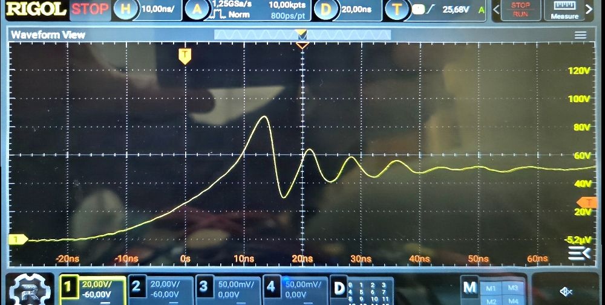 | 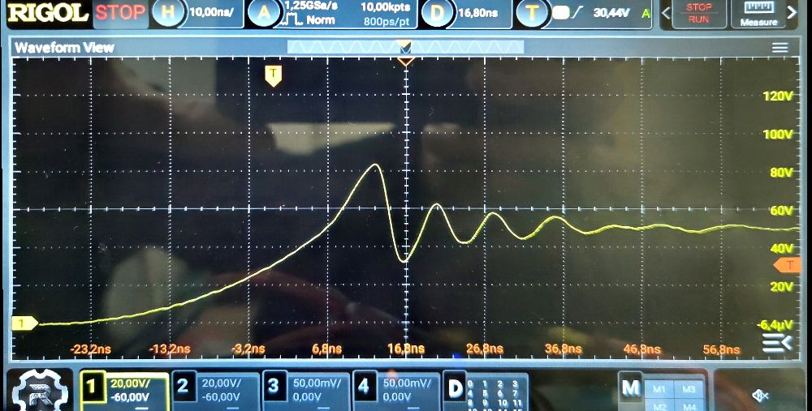 |

**Почему так (связь с разводкой).**
- Спад тока LS очень быстрый: общий участок истока у LS мал (2.3). При этом R_off почти не помогает — у B он в
  1.37 раза больше, а выброс меньше всего на 10 %. **Оценка:** L_cs(LS) ≈ 0.3–0.5 нГн по формуле
  `di/dt = gm·(Vpl − Voff)/(C_iss·R_off + gm·L_cs)`.
- Петля ~1 нГн замыкается через порезанный In3 и 0603.

**Что даёт каждый рычаг** (оценка по той же формуле, 120 А, на ключ из двух WMB043):

| Мера | di/dt, А/нс | ΔV при L петли 1.0 нГн | при 0.6 нГн | Цена |
|---|---|---|---|---|
| как сейчас (A: R_off 2.7 Ом с Rg_int) | 13–19 | 24–35 В | 14–21 В | — |
| R_off до 6.3 Ом (+5 Ом в цепи выключения) | 10–13 | 19–25 В | 11–15 В | фронт напряжения ×2.3, Eoff растёт |
| R_off до 10 Ом | 8–10 | 15–19 В | 9–11 В | фронт ×3.7 |
| RC-снаббер (k 1.85 → ~1.2) | — | −35 % | −35 % | 0.15–0.22 Вт на ключ при 48 В, 20 кГц |

**Вывод:** R_off — слабый и дорогой рычаг. Главные — **L петли** (сплошная пара In2/In3 и керамика у стойки) и
**снаббер**. Для 72-вольтового варианта без этого не обойтись: 72 В + 37 В > 100 В.

**Уверенность.** Выброс — стенд, но до Р1 (наводка на щуп) часть может оказаться наводкой: при 35 А/нс связь
0.2–0.5 нГн даёт 7–17 В. Связь с разводкой — разводка плюс оценка.

### 3.2 Асимметрия HS и LS

**Стенд (прежний, документ 33 в pslc):** выброс при выключении HS — 8–16 В при 20–150 А; фаза тогда не
записана.

**Разводка:** возврат затвора HS — через узел у шунта (2.3), большая петля вокруг ключа.
- **Гипотеза:** большая индуктивность петли затвора HS и её связь с силовым контуром замедляют спад тока HS.
  Отсюда меньший выброс, но и хуже управляемость: звон затвора при R_g 1 Ом, бугорки.
- **Проверка** — Р2 (§7): выброс HS на той же фазе.
- **Для доработки:** вести HO и SW парой к выводам истока HS. Спад тока HS станет быстрым, как у LS, —
  учитывать вместе с §3.1.

### 3.3 Наброс на затвор выключенного ключа

**Стенд** (на выводах, от уровня выключенного затвора):

| | 0 А | 20 А | Ширина на полувысоте |
|---|---|---|---|
| Плата A | 2.9–3.0 В | 2.8 В | 16–18 нс |
| Плата B | 2.9 В | 3.0–3.4 В | 16–18 нс |

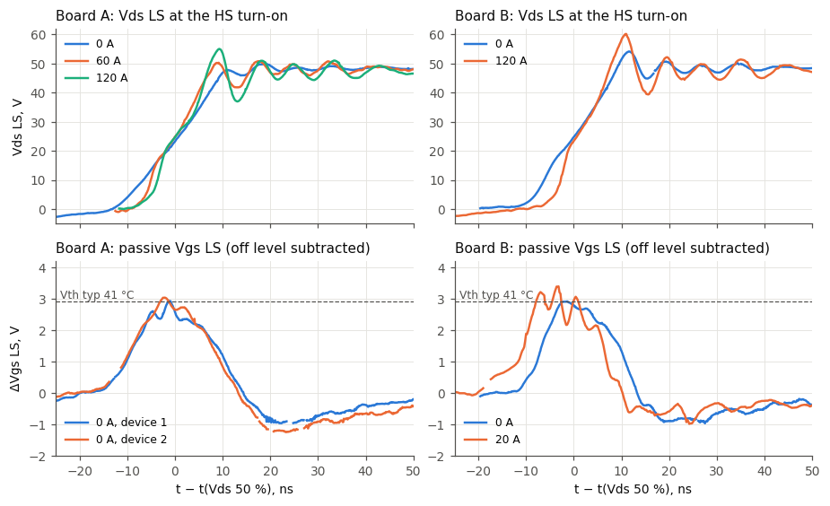

- На плате B пик выше Vth typ (2.9 В) примерно на 5 нс. При горячем приборе (−5…−6 мВ/K) и Vth min 2 В запаса
  нет. Мерили только затвор LS.
- **Разводка:** петля LO длиной ~35 мм — путь, которым драйвер держит затвор. Индуктивность дорожки мешает
  держать затвор на фронте 10–15 нс.
- **Для доработки:** место под C_gs у выводов G/S каждого ключа (ёмкостный делитель, наброс ∝ 1/(C_iss + C_gs)).
  Затворные пары короче (§5). Кламп Миллера — по желанию, место без установки; он ускоряет выключение (§3.1).

### 3.4 Просадка узла и второй бугорок (плата B, 20 А)

**Стенд:**
- через 69 нс после включения HS узел проседает с 48 до 24 В, ширина на полувысоте 23–24 нс;
- затем второй бугорок на затворе LS (+1.3 В) — dv/dt возврата узла через Cgd;
- LS в это время закрыт (Vgs −1 В);
- на плате A и на B при 120 А этого нет;
- цена — 11–13 мкДж за период, 0.21–0.25 Вт на стойку при 20 кГц.

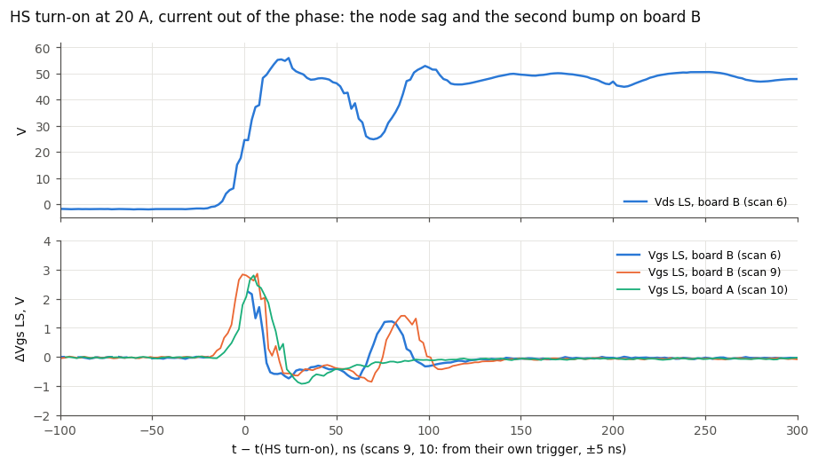

| B, 20 А, обзор (снимок 6) | B, 20 А, фронт (снимок 7) |
|---|---|
| 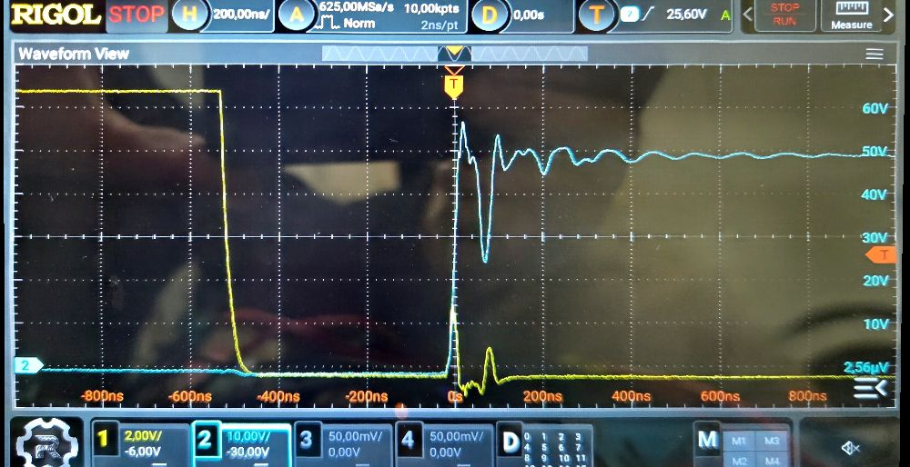 | 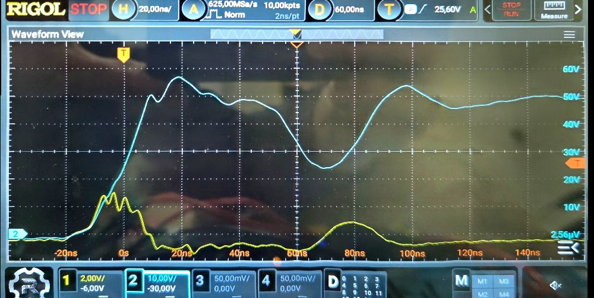 |

**Гипотеза.** HS частично закрывается. Кандидаты по разводке:
1. помеха на HI от узла — HI начинается у конца пура узла, RC нет (2.4);
2. звон большой петли затвора HS при R_g 1 Ом (2.3);
3. провал бутстрепа — маловероятно: петля короткая, UVLO 7.4–8.3 В при ~11 В.

**Проверка** — Р4 (§7).

### 3.5 Что не проблема платы

- Выброс восстановления на пассивном ключе — 51–60 В при 48 В, ниже прогноза pslc.
- Ёмкостный фронт при малом токе.
- Провал Vgs активного LS в конце включения (4.0–5.3 В) — показание через L_cs: Vds стоит у нуля, повторной
  коммутации нет.
- Плато Миллера на кристалле ниже даташита; платы A и B отличаются на 0.45–0.55 В — разброс приборов. К
  разводке не относится, но запас против ложного включения считать от Vth min.

---

## 4. Что можно сделать на собранных платах — и что это проверит

| № | Доработка | Где | Что проверяет | Ожидание (оценка) |
|---|---|---|---|---|
| Д1 | **RC-снаббер на LS:** C 3.3–4.7 нФ 100 В (0805/1206 X7R/C0G) + R 0.47–0.56 Ом (2 × 1206 параллельно или 2010), от пура узла к полосе GND, у ключей LS | одна фаза | вклад звона в выброс | ΔV −30…−40 %, звон затухает за 1–2 периода |
| Д2 | **Керамика у стойки:** 2–3 × 1206 1 мкФ 100 В X7R от VDC к GND у каждой стойки, рядом с C92/C93/C94, с виа на In2/In3 | одна фаза, потом все | вклад L петли | звон выше 140 МГц, ΔV ниже пропорционально √L…L |
| Д3 | **C_gs 4.7 нФ** поверх R_gs (R19 и соседние) у каждого прибора одной фазы | одна фаза платы B | наброс и выброс | наброс −30…−45 %, выключение медленнее (C_iss +90 % у WMB043 5.3 нФ) |
| Д4 | **R_g 1 → 2.7 Ом** на одной фазе платы B (опыт Р5) | одна фаза платы B | сколько R управляет di/dt | отношение di/dt 0.79–0.85 при L_cs 0.3 нГн, 0.91–0.95 при 1.5 нГн |
| Д5 | **C 100 пФ от HI и LI к GND** у выводов D4 (выводы 1, 2 и 3 — в 1.3–2.5 мм) | фаза с просадкой | помеха на входе (3.4) | если просадка уходит — причина во входе |

Д1–Д3 ставить по одной и снимать базовый набор Б1–Б5 (§7) до и после, на одной фазе.

---

## 5. Что менять в разводке этой версии (PDFN 5×6)

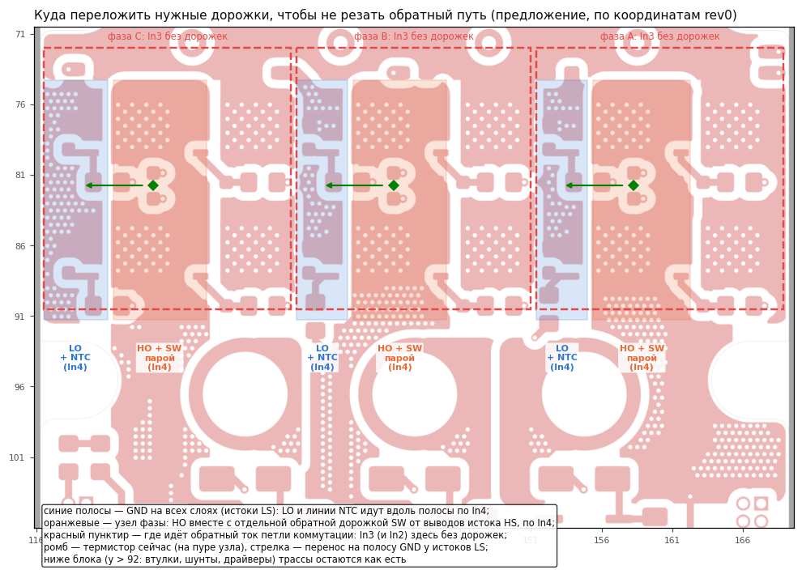

*Рис. 5. Куда переложить нужные дорожки внутри блока: каждая — в медь своего опорного потенциала, In3 под ключами остаётся сплошным.*

| № | Что | Почему (раздел) | Приоритет |
|---|---|---|---|
| 1 | **In3 под ключами — без пересечений, In2 — сплошной VDC** (пара на 0.1 мм). Дорожки не убираются, а **перекладываются в «свою» медь** — рис. 5: • **LO** — вдоль полосы GND своей фазы (x 116–121 / 134–138 / 151–155; там GND на всех внутренних слоях) по In4. Полоса — опорный слой и возврат затвора LS; дорожка идёт параллельно обратному току. • **HO** — по In4 внутри узла своей фазы (x 121–128 / 138–145 / 155–162), **парой с отдельной дорожкой SW от выводов истока HS** (п. 4). Узел — опора затвора HS. R_g HS перенести на сторону узла, к выводу G (сейчас R23/R1 стоят над стоком HS). • **NTC** — термистор перенести с пура узла на полосу GND у истоков LS. Тогда +3.3 В и линия к U1–U3 идут вдоль полосы по In4, как LO. Схема делителя не меняется, датчик остаётся у LS (меряет у истоков, а не у стока — сравнить с прежним положением на стенде). • Ниже блока (втулки, шунты, драйверы) трассы — как есть. Проверить по месту: полосы GND узкие (4–5 мм) и в виа (92 / 38 / 34 по фазам C / B / A), дорожка 0.5 мм должна пройти между ними с зазором. Пуры узлов и VDC на F.Cu, In1, In4, B.Cu сохраняются — им нужна медь под ток при 35 мкм; на In4 их прорежут только узкие дорожки вдоль тока | 2.2, 3.1 | **высокий** |
| 2 | **Керамика у каждой стойки:** 4–6 × 1206/1210 100 В X7R на фазу (вместо 0603), одинаково на фазах. Каждый — своей парой виа на In2/In3, вплотную к стоку HS и истоку LS (например, на B.Cu под стыком сток HS / полоса GND соседней фазы и над LS, или на F.Cu у верхней кромки блока). Цель — L петли ≤ 0.6 нГн | 2.1, 3.1 | **высокий** |
| 3 | **Места под RC-снаббер (без установки)** на LS и HS каждой фазы: C 0805/1206 100 В, R 2010 или 2 × 1206. Петля снаббера — у выводов D/S (LS: пур узла ↔ полоса GND; HS: VDC ↔ узел у верхней кромки) | 3.1 | **высокий** |
| 4 | **Затворные пары:** HO рядом с отдельной дорожкой SW, которая подключена **у выводов истока HS**, а не к узлу у шунта. LO — над полосой GND, возврат через неё у выводов истока LS. Маршруты — п. 1. Драйвер ближе к блоку, если позволяет место | 2.3, 3.2, 3.3 | **высокий** |
| 5 | **Цепь затвора на каждый прибор:** R_on (есть), диод + R_off (раздельный путь выключения, место под R_off), C_gs у выводов G/S (DNP по умолчанию), по желанию — место под кламп Миллера (DNP) | 3.1, 3.3 | средний |
| 6 | **RC на HI/LI** у D4–D6 (R 0–5 Ом, C 100 пФ DNP); трассы HI/LI — над GND, подальше от пура узла и куста виа у шунта | 2.4, 3.4 | средний |
| 7 | **Симметрия фаз:** одинаковые керамика и число виа у истоков LS (сейчас 92 / 38 / 34) и HS (6 / 65 / 40), одинаковые длины затворных пар; HS фазы A сейчас в стороне от D6 | 2.1, 2.3 | средний |
| 8 | **Площадки для щупа:** пара VDC/GND у каждой стойки рядом с керамикой (лепестки тока восстановления, опыт Р3); пара BST/SW у каждого драйвера; площадка HI (и LI) рядом с GND драйвера; пара G/S у HS для math или дифференциального щупа. Шаг пары — под пружинную землю щупа (уточнить у владельца) | 1, 7 | средний |
| 9 | Цепи NTC — в п. 1. Если термистор оставить на узле, линии к нему ведут внутри узла парой (+3.3 В и сигнал рядом), а не по In3; помеху от узла на высокоомный вход U1–U3 гасить RC у входа | 2.2 | низкий |

---

## 6. Что ещё проверить в проекте без стенда

1. **Оценить индуктивности по геометрии** — петля коммутации по фазам, петли затворов HS и LS — инструментом
   KiCad или прикидкой по площади. Сверка со стендом: L петли ≈ 1 нГн, L_cs(LS) ≈ 0.3–0.5 нГн.
2. **Фактические номиналы 0603** C90, C92…C96 по закупке (`REV1_TASK.md` §0.3).
3. **Токовая нагрузка меди:** медь 35 мкм на всех слоях при 120–150 А амплитуды. Ширина и число слоёв путей
   узел → шунт → втулка и VDC/GND к ключам. С переносом дорожек из In3 (§5, п. 1) не потерять сечение.
4. **Где проходят +12 В и +3.3 В,** если их убрать из In3 под блоком.
5. **Повторить мой разбор для фаз B и A** по пп. 2.3–2.4: сделан скриптом, глазами проверена фаза C.

---

## 7. Что доснять на стенде — и что это решит для разводки

Программа опытов — `power_loss_calc/docs/validation/program_osc.md` (v9.2); номера оттуда.

| Опыт | Что даёт | Что решает для доработки |
|---|---|---|
| **Р1** — наводка на щуп: остриё и земля на истоке LS при выключении 120 А | доля наводки в выбросе | верность §3.1 |
| **Базовый набор Б1–Б5 на фазах A, B, C**, обе платы | разброс фаз: выброс, звон (L петли по фазе), наброс, просадка | сказывается ли асимметрия 0603 и виа (2.1); приоритет п. 7 §5 |
| **Р2** — выброс выключения HS (ток вытекает; math «шина − Vds LS») | L_cs у HS, звон HS | гипотеза 3.2; как вести SW (п. 4 §5) |
| **Р6** — звон при Vdc 36 и 48 В | L петли и Coss раздельно | пересчёт на 72 В; цель L петли (п. 2 §5) |
| **Р5 / Д4** — R_g 1 → 2.7 Ом на одной фазе B | как R управляет di/dt | нужен ли раздельный R_off (п. 5) |
| **Д1, Д2, Д3** — снаббер, керамика, C_gs по одной | вклад каждой меры | номиналы и места для пп. 2, 3, 5 |
| **Р4** — затвор HS (math), вход HI, BST−SW при 10–40 А на B; затем Д5 | причина просадки | нужны ли п. 6 и п. 4 для HS |
| **Статический Vth** на 2–3 приборах каждой платы | запас против ложного включения | номинал C_gs |
| **K1** — электрический свип частоты на A и B при 20 и 80 А (`program_calorimetry.md`) | цена ложного включения и просадки в ваттах | срочность пп. 4–6 |

---

## 8. Числа

| Величина | Значение | Источник |
|---|---|---|
| L петли коммутации, фаза C | 0.9–1.1 нГн (звон 125–139 МГц) | стенд |
| L_cs (общий участок истока) LS | 0.3–0.5 нГн | оценка по стенду |
| L_cs HS | 1–2 нГн | оценка по прежним данным (33); проверка Р2 |
| Спад тока LS при 120 А | ~6 нс, ~20 А/нс на ключ | стенд |
| Выброс / (L·di/dt) | ~1.85 | стенд |
| Выброс выключения LS, ΔV | 3 / 22 / 33 / 37 В при 20 / 60 / 100 / 120 А | стенд (A; B на ~10 % ниже) |
| Наброс на затвор LS | 2.8–3.4 В, 16–18 нс | стенд |
| Выброс восстановления | 51–60 В при 48 В | стенд |
| Просадка узла (B, 20 А) | до 24 В, 23–24 нс, через 69 нс | стенд |
| Стек | 0.1 / 0.485 / 0.1 / 0.485 / 0.1 мм, медь 35 мкм | разводка |
| HO / LO по In3 | 27–31 / 30–35 мм | разводка |
| Драйвер — ключи | 17–30 мм | разводка |
| Coss WMB043 при 48 В | ~0.83 нФ на прибор | даташит (библиотека pslc) |
| UVLO бутстрепа NSD1624 | 7.4–8.3 В при спаде | даташит |

---

## 9. На следующую ревизию (TOLT) — коротко

Для `REV1_TASK.md`, когда до неё дойдёт.
- **Бюджет выброса в §1.5 считает спад тока за 60 нс.** Стенд показывает ~6 нс уже при 120 А.
- При клампе Миллера у выводов и раздельных возвратах драйвера спад тока задаёт `gm·L_cs`. Оценка для
  IAUS300N10S5N015T: 13–33 В при L петли 1.5 нГн против бюджета 16 В.
- Заложить места под снаббер и под резистор в цепи клампа; проверять выброс ступенями тока на первом включении.

Подробности — в истории этого файла (коммит c92b577).

---

## 10. Источники и как пересобрать

В проекте pslc (`~/Git/PC/power_loss_calc`):
- протокол стенда со всеми 38 снимками: `docs/validation/bench_2026-10-13/protocol.md`;
- оцифрованные кривые и числа: `docs/validation/bench_2026-10-13/csv/`, `metrics.csv`, `model.json`;
- программы опытов: `docs/validation/program_osc.md`, `program_calorimetry.md`;
- картинки стенда (`img/f*.png`, `img/scan*.jpg`) — оттуда же.

Здесь:
- картинки разводки (`img/L*.png`): `python3 bench_2026-10-13/tools/layout_figures.py` из корня проекта (нужны
  kicad-cli и inkscape; плата копируется во временную папку, координаты подписей — rev0);
- разбор `.kicad_pcb` — `tools/kpcb.py`.
