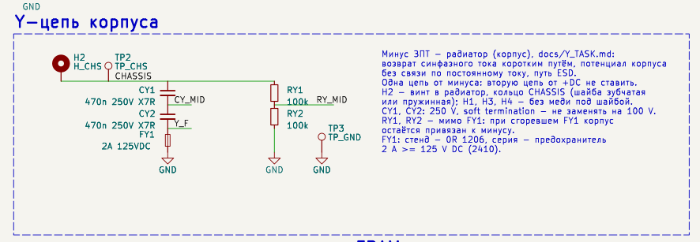
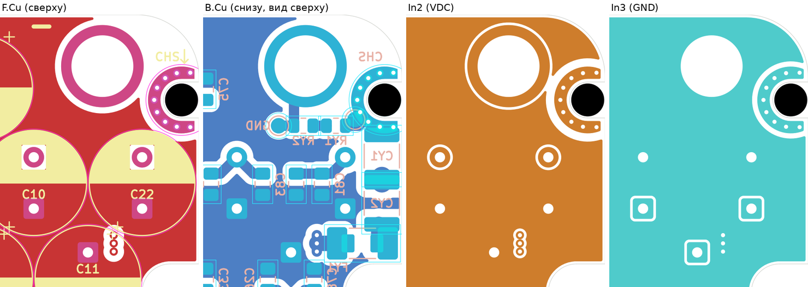
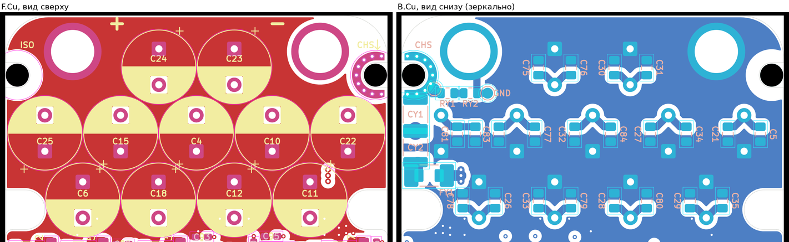

# Y-цепь корпуса: отчёт по `docs/Y_TASK.md`

Ветка `rev0.1-adapto`, 2026-10-22. Верх и ширина платы как в MINICONTROLLER_ADAPTO (вариант V1: верхняя зона ADAPTO на
3 мм выше, полоса снабберов сохранена). Плата была 53 × 101 мм, после сжатия зоны МК стала 53 × 98 мм (`lay_MC1.py`; на
Y-цепь это не повлияло). Скрипты: `tools/rev01_layout/adapto.sh` (шаги `lay_AD1.py`,
`fp_y.py`, `sch_rev01_j.py`, `lay_Y1.py`), проверки — `tools/rev01_layout/y_checks.py`.

## 1. Что сделано

| Пункт ТЗ | Сделано |
|---|---|
| 3.2, 3.3 | Одна цепь `CHASSIS — CY1 — CY2 — FY1 — GND`, параллельно стеку `CHASSIS — RY1 — RY2 — GND` (мимо FY1). Внутренние узлы `CY_MID`, `Y_F`, `RY_MID` |
| 3.1 | Блок «Y-цепь корпуса» в рамке на корневом листе (там же, где ЗПТ), с поясняющим текстом и ссылкой на ТЗ |
| 3.4 | H2 стал `MountingHole_Pad` (значение `H_CHS`) на цепи `CHASSIS`; H1, H3, H4 остались без площадки |
| — | Убраны прежние H5 (винт CHASSIS между J4 / J5) и симметричная пара C135 (VDC–CHASSIS) / C136 (GND–CHASSIS): в верхней зоне ADAPTO для них нет места, а ТЗ требует одну цепь от минуса |
| 3.5 | KiCad-варианты в проекте не используются, поэтому у FY1 есть поле `Variant`: «Стенд: 0R 1206 (RC1206JR-070RL); Серия: предохранитель 2410 2A >= 125V DC (0453002.MR)». Колонки `Variant` и `Note` добавлены в шаблон BOM проекта |
| 3.6 | Поля `MPN`, `Alt_MPN`, `Note`. Те же номера записаны в колонки BOM проекта `Product Name` и `Replacement`. У CY1 и CY2 в `Note`: «soft termination, 250 V — не заменять на 100 V» |
| 4.2 | Кольцо H_CHS — подкова: паз ADAPTO открыт к краю, поэтому полного кольца не получится. Подробности в разделе 3 |
| 4.3 | У H1, H3, H4 нет меди ближе 3.5 мм от центра ни на одном слое |
| 4.4 | Цепочка стоит на B.Cu у H2, раскладка в разделе 4 |
| 4.5 | Netclass `Y_CHASSIS` (`CHASSIS`, `CY_MID`, `Y_F`): зазор 0.5 мм, дорожка 1.0 мм. Правила в `Power.kicad_dru`: 0.8 мм до VDC и фазных узлов, 2 мм от `CHASSIS` и `CY_MID` до фазных узлов. Прежнее правило «CHASSIS 2 мм» ушло вместе с H5 |
| 4.6 | Шелкография: `CHS` со стрелкой у H2 на F.SilkS, `CHS` на B.SilkS, `ISO` у H1, H3, H4 |

## 2. Выбор отверстия (4.1)

Минус ЗПТ — это втулка J5 (вход минуса батареи), минусовые выводы электролитов и сплошные GND-плоскости In1 / In3 / In4
под всей зоной ЗПТ. Ближе всех к ним H2, правый U-паз верхней зоны:

- от центра H2 до центра J5 8.35 мм, от наружного края кольца до площадки J5 1.10 мм;
- H1 стоит симметрично у J4, но J4 — это плюс (VDC);
- H3 и H4 — винты прижимной пластины у нижнего края, до ЗПТ от них больше 60 мм.

**Длина пути `GND → FY1 → CY2 → CY1 → кольцо`: 17.2 мм** по центрам площадок, от ближайшей GND-виа до края кольца.
Это больше критерия 15 мм:

- шаги площадок сами по себе дают 13.1 мм: у CY по 4.1 мм, у FY1 (2410) 4.91 мм;
- цепочку пришлось уложить буквой «Г»: место под ней ограничивают выводы C22, втулка J5, вывод C11 и вырез под винт
  прижимной пластины.

С 1210 вместо 1812 путь стал бы короче примерно на 2 мм. Но единственный найденный 1210 на 470 нФ / 250 В с мягкими
выводами (KEMET C1210X474KARACTU) имеет высоту 2.8 мм и не в наличии, поэтому оставлен 1812. Путь меньше 25 мм, так что
вопроса о переносе компонентов ЗПТ (второй абзац п. 4.1) не возникает. Площадь петли — полоса 3.4 мм шириной вдоль
правого края.

## 3. Кольцо H_CHS (4.2)

Посадочное место `Power_My:MountingHole_3.2mm_M3_Slot_CHS` (`fp_y.py`, библиотека `Lib/Power_My.pretty` добавлена в
`fp-lib-table`):

- Паз 3.5 мм открыт к краю, край платы проходит в 1.68 мм правее центра винта. Поэтому кольцо — подкова:
  - радиус от 2.05 до 3.25 мм, то есть наружный диаметр 6.5 мм (головка M3 5.5 мм + 1 мм);
  - ножки идут вдоль паза до 1.25 мм вправо от центра, до края остаётся 0.43 мм;
  - верхняя ножка обходит скругление угла платы r 6.
- Медь на F.Cu и на B.Cu, маска открыта с обеих сторон.
- 9 переходных площадок со сверлом 0.4 мм и диаметром 0.7 мм посередине кольца, ТЗ требует не меньше 8.
- На In1–In4 такая же подкова сделана зонами `CHASSIS` с приоритетом 50 и сплошным подключением к виа. Плоскость VDC на
  In2 отступает от неё на 0.8 мм, плоскости GND — на 0.5 мм.
- Отверстие NPTH 3.2 мм в конце паза сохранено, как у стандартного посадочного места, но без зазора 2 мм, который стоит
  у H1, H3, H4.
- Цепь `CHASSIS` есть ровно на H2 (кольцо и виа), CY1.1, RY1.1 и TP2. Заливки `CHASSIS` нет, кроме колец.

Шайба под головкой ложится на подкову примерно на 2/3 окружности. Оставшаяся треть приходится на паз. Контакт также
идёт через резьбу в радиаторе.

## 4. Размещение (4.4)

Все детали Y-цепи стоят на B.Cu. На F.Cu у H2 места нет: там втулка J5 с наконечником кабеля и корпус C22.

| Поз. | Место (мм), поворот | Примечание |
|---|---|---|
| CY1 | (167.30, 54.25), 270° | стоит вертикально, вдоль правого края (ближайшая кромка, линия изгиба от винта). Площадка CHASSIS лежит на кольце |
| CY2 | (167.30, 58.85), 270° | торец к торцу с CY1: площадки CY_MID перекрываются на 0.9 мм (общая средняя площадка), перемычка 2 мм |
| FY1 | (165.42, 62.75), 0° | поперёк под CY2. Площадка Y_F налегает на площадку CY2 и прошита дорожкой 1.5 мм. Площадка GND идёт дорожкой 1.5 мм к трём GND-виа 0.8 / 0.4 мм в (161.0, 61.95 / 62.75 / 63.55), то есть прямо в плоскости минуса In1 / In3 / In4 |
| RY1, RY2 | (162.85, 51.3), (159.70, 51.3), 180° | горизонтально под J5. От кольца к RY1 идёт дорожка CHASSIS 1.0 мм, от RY2 — прямо вверх в площадку J5 |
| TP2 (TP_CHS) | (164.70, 50.70) | пятно 1.5 мм на дорожке кольцо–RY1 |
| TP3 (TP_GND) | (157.30, 51.30) | пятно 1.5 мм у GND-площадки RY2, подпись `GND` на B.SilkS |
| C82 | (166.0, 57.0) → (159.0, 57.0) | MLCC электролита C22 перенесён левее C81, чтобы освободить полосу у края. GND-площадка подведена отрезком 1 мм к C81 |

**Ширина дорожек:**
- CHASSIS 1.0 мм;
- CY_MID 2.0 мм;
- Y_F 1.5 мм;
- от Y_F к GND 1.5 мм.

Переходов слоёв от кольца к CY1 и RY1 нет.

## 5. Зазоры (4.5) и остальные отверстия (4.3)

Результаты `y_checks.py` и DRC:

- от меди `CHASSIS` / `CY_MID` / `Y_F` до меди фазных узлов (`/Driver_*/SW`, `/Current_Sensor_*/Phase_*`) не меньше
  9.3 мм на любом слое (требуется 2 мм);
- до VDC на том же слое DRC держит 0.8 мм. Выборка `y_checks.py` даёт 0.70 мм, но это углы прямоугольного приближения
  скруглённых площадок, а не реальный зазор;
- у H1, H3, H4 нет меди ближе 3.5 мм от центра ни на одном слое, включая залитые плоскости. Шайба M3 7 мм туда
  помещается. ТЗ требует диаметр «отверстие + 2 мм», то есть радиус 2.6 мм. Посадочные места H1, H3, H4 держат зазор
  2 мм от края отверстия, медь начинается с радиуса 3.6 мм;
- винты прижимной пластины в боковых вырезах владелец оставил как есть: пластина прижимает плату через термопрокладку.

## 6. BOM

Наличие проверено на DigiKey 2026-10-22. Mouser и LCSC проверить не удалось.

| Поз. | MPN | Alt_MPN | Параметры | Высота макс. |
|---|---|---|---|---|
| CY1, CY2 | KEMET C1812X474KARACAUTO (FT-CAP, AEC-Q200, 1236 шт.) | TDK CGA8N3X7R2E474K230KE (2500 шт.); Murata GCJ43DR72E474KXJ1L (67 шт.) | 470 нФ ±10 %, 250 В, X7R, 1812, мягкие выводы | 1.85 мм (TDK 2.6, Murata 2.3) |
| FY1, серия | Littelfuse 0453002.MR (сейчас 0 шт., поставка 14.12.2026) | Littelfuse 0451002.MRL (те же параметры, позолоченные колпачки, 20209 шт.) | 2 А, очень быстрый, 125 В AC/DC; отключающая способность 50 А при 125 В DC и 10 кА при 75 В DC | 2.94 мм |
| FY1, стенд | Yageo RC1206JR-070RL (0 Ом 1206) | — | 1206 становится на внутренние площадки посадочного места | 0.6 мм |
| RY1, RY2 | Yageo RC0805JR-07100KL | Panasonic ERJ-6GEYJ104V | 100 кОм ±5 %, 0805, 1/8 Вт, 150 В | 0.6 мм |
| TP2, TP3 | — | — | пятно 1.5 мм, исключено из BOM | — |

- **Отключающая способность FY1:** 10 кА указаны только до 75 В DC. При шине 73 В запас тонкий, выше 75 В остаётся только
  50 А.
- **Посадочное место FY1:** `Power_My:Fuse_2410_1206`. Площадки 2410 по даташиту Littelfuse 451/453: 1.96 × 3.15 мм,
  шаг 4.91 мм. Площадки 1206 (1.25 × 1.75 мм, шаг 2.8 мм) лежат внутри них.
- **Даташиты:**
  - KEMET C1013 (FT-CAP): https://yageogroup.com/content/datasheet/asset/file/KEM_C1013_X7R_FT-CAP_SMD
  - KEMET C1078 (FT-CAP AUTO): https://yageogroup.com/content/datasheet/asset/file/KEM_C1078_X7R_FT-CAP_AUTO_SMD
  - TDK: https://www.digikey.com/en/products/detail/tdk-corporation/CGA8N3X7R2E474K230KE/3248533
  - Littelfuse 451/453, ред. 08/23/21 (копия; littelfuse.com не отдал PDF):
    https://sy-dep-epc-lpc.web.cern.ch/components/datasheets/epc-lpc%20(converters)/451-453_Fuse_(LITTLEFUSE).pdf
  - Yageo RC group, v14: https://yageogroup.com/content/datasheet/asset/file/PYU-RC_GROUP_51_ROHS_L
  - Panasonic ERJ: https://industrial.panasonic.com/cdbs/www-data/pdf/RDA0000/AOA0000C301.pdf

  У Murata и TDK PDF с сайтов не скачались, поэтому их высоты и AEC-Q200 взяты со страниц DigiKey.

## 7. Проверки по п. 5.1

| Пункт | Результат |
|---|---|
| ERC / DRC | DRC: 0 нарушений, 0 неразведённых, паритет со схемой 0. ERC: 9 ошибок — прежняя база (`U6`, `#PWR04`), новых нет. Netclass `Y_CHASSIS` применён |
| Состав `CHASSIS` | H2.1 (H_CHS), CY1.1, RY1.1, TP2.1 — ничего больше. На плате нет USB или экранов разъёмов, других связей корпуса с землёй нет (п. 6 ТЗ) |
| Три прочих отверстия | у H1, H3, H4 меди нет ближе 3.5 мм ни на одном слое |
| Длина пути GND → H_CHS | 17.2 мм, см. раздел 2 |
| 3D-вид | не смотрел. Шайба ложится на открытую подкову, у остальных отверстий — на маску (медь начинается с радиуса 3.6 мм). Проверить в 3D-просмотрщике |
| BOM | MPN и Alt_MPN заполнены. 250 В и 125 В DC проверены по таблицам даташитов (KEMET, Littelfuse) и по DigiKey (TDK, Murata) |
| Отчёт | этот файл; вопросы — `docs/REV1_QUESTIONS.md` |

`hv.py` (открытая медь ближе 0.5 мм при шине 84 В) даёт 23 находки, столько же, сколько до изменений.

## 8. Сборочная записка (4.6)

- Под головку винта H2 (H_CHS) ставить зубчатую (DIN 6797) или пружинную (DIN 127) шайбу M3. Если винт идёт в стойку —
  стойка стальная оцинкованная, не анодированная.
- Остальные винты (H1, H3, H4 и винты прижимной пластины) электрического контакта не имеют, допустимы пластиковые шайбы.
- Момент затяжки общий для платы.
- **На стороне B.Cu, обращённой к радиатору, в верхней зоне стоят высокие детали.**
  - CY1, CY2 — до 1.85 мм (TDK до 2.6 мм), FY1 — до 2.94 мм. MLCC 0805 под электролитами стояли там и раньше,
    высотой около 1.25 мм.
  - Под прямоугольником примерно x 156–169, y 49–66 мм радиатору нужен карман или зазор не меньше 3.2 мм, либо плата
    должна стоять на стойках.
- Кольцо H2 на B.Cu касается радиатора или стойки, и это тоже контакт CHASSIS.

